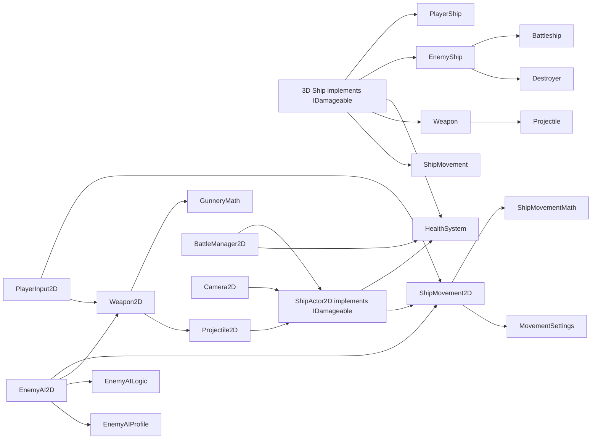

# GrandNavigation Minimal Playable 2D V1.0

## 真实开发顺序与运行

基线：`feature/seamless-gameflow` / `b3c5b41`，真实冻结标签 `3d-pre-2d-adaptation`。新增分支 `feature/battle-2d`。实际顺序是 **3D → 2D 适配**，没有修改、倒签或伪造历史。老师 Route B 要求先冻结 2D 再开发 3D，与本项目不一致；提交前必须向教师说明并确认是否接受。不能把本次分支称为历史上的 2D 起点。

Unity 6000.3.27f1，沿用仓库 Package，不需安装新依赖。
- 2D：打开 `Assets/_Game/Scenes/Battle2D.unity`，Play → Start Game。W/S 调整并保持目标航速，A/D 操舵，滚轮缩放，右键敌舰锁定，左键向鼠标世界坐标齐射，Esc 解锁。锁定只提供目标反馈，不自动命中。胜负后 Retry 重载场景，回到 Start Game。
- 3D：打开 `Assets/_Game/Scenes/IntegratedGame.unity`。原 Main Menu → Preparation → GO → Gameplay → Result 流程保留。构建列表仍以 3D 为首场景，Battle2D 已加入；单独发布 2D 时在自己的 Build Profile 中选择 Battle2D 为启动场景。

## 规则对照与范围

| 规则 | 3D | 2D |
|---|---|---|
| 航行 | XZ、Rigidbody、Y 轴转向 | XY、Rigidbody2D、Z 轴转向、本地 +Y 舰首 |
| 航速、倒车、舵角 | 目标速度、加减速、倒车反舵 | 同一运动数学，由 2D 物理执行 |
| 主炮 | 固定初速重力弹道、真实炮塔射界 | 直线炮弹、最多六发齐射、装填、散布；无复杂炮塔动画 |
| 命中 | 3D 连续检测 | Physics2D.CircleCast 逐段检测、岛屿阻挡、一次伤害 |
| HP | HealthSystem + IDamageable | 同一组件和接口；非友军实际命中扣血 |
| AI | 原完整 FSM / 导航 | 共享状态转换，启用 Patrol/Approach/Engage/Destroyed；简单局部避障 |
| 胜负 | 全指定敌舰死亡胜利，玩家死亡失败，同帧失败优先 | 同规则，独立 2D 注册和生命周期适配器 |
| Retry | 重载正式场景 | 重载 Battle2D，清除弹丸和状态 |

2D 直线炮弹是范围控制下的弹道简化，**不等同 3D 重力弹道**。未复制复杂预测、55px 吸附、遮挡缓冲、260°炮塔限制、3D 撤退与高级航路。

## 实际共享、修改、新增

原样调用的核心类型（7）：`IDamageable`、`HealthSystem`、`MovementSettings`、`ShipMovementMath`、`GunneryMath`（Gaussian）、`EnemyAIProfile`、`EnemyAILogic`（Decide/DiskError）。另共享 `EnemyState`、`BattleState` 枚举。HealthSystem 仍是 Unity 组件，不声称完全独立于引擎。

原有 C# 类型修改：**0**。3D Ship 强依赖具体 Weapon/ShipMovement/Rigidbody，本次没有为了继承复用而改造整个 3D 执行层。

2D 新增运行时组件（8）：
- ShipActor2D：身份、阵营、组合生命与运动，实现同一 IDamageable。
- ShipMovement2D：共享速度/舵角算法，Rigidbody2D 执行。
- PlayerInput2D：Input System 驾驶、锁定、发射指令。
- Weapon2D：齐射、装填、共享散布算法、生成炮弹。
- Projectile2D：2D 直线运动、连续碰撞、敌我过滤和一次伤害。
- EnemyAI2D：共享 FSM 规则的 2D 感知/导航/射击适配。
- Camera2D：正交跟随与滚轮缩放。
- BattleManager2D：开局敌舰注册、死亡事件、统一 LateUpdate 失败优先、开始/结算/重载 UI。只共享结果枚举与规则语义，**没有直接复用 3D BattleManager 实现**。

`ShipKind2D` 区分大型/小型/玩家，不声称 2D 继承 3D Battleship 或 Destroyer。原有 3D Ship → PlayerShip / EnemyShip → Battleship / Destroyer 继承关系完整保留。课程若要求两版必须使用完全同一继承树，需要教师确认，本次选择避免侵入式重构。

## Class Map 草案

箭头在继承部分表示派生，其余表示持有或使用；不是严格 UML。新增 AircraftCarrier 等 3D 子类仍可按原结构扩展；2D 不伪装为该继承链的实例。

## Change Map

| 文件/区域 | 变化 | 原因 |
|---|---|---|
| 原有 Gameplay/AI/BattleResult/Seamless 脚本及 3D 场景、Prefab | 不变 | 保留可运行 3D 基线 |
| Battle2D/Runtime | 新增 8 个执行组件 | 2D 物理、输入、相机和生命周期不同 |
| Battle2D/Editor | 新增场景、战斗、UI 三个一次性配置器 | 创建真实保存场景；不会运行时重建地图 |
| Battle2D/Profiles | 新增大型/两艘小型配置资产 | 不修改原有 3D AI 数值 |
| Battle2D/Prefabs/Shell2D.prefab、Sprites/White.png | 新增 | 程序化简单视觉，无外部素材 |
| Scenes/Battle2D.unity | 新增 | 独立开始/战斗/结算循环 |
| EditorBuildSettings.asset | 追加 2D 场景 | Retry 可加载，保留原启动顺序 |
| Battle2D/Tests、README | 新增 | 可重复测试与真实开发证据 |

二维地图约 400×400，三座岛屿与边界均为 Collider2D。玩家 HP600；大型 HP250/最高速10/齐射4/装填5秒；小型 HP125/最高速14/齐射2/装填4秒；玩家最高速15/倒车4/齐射6/装填3秒；炮弹速度100、范围300、每发25伤害。参数在对应场景组件和 Profile 可调。

AI Profile 只复用适用字段：2D retreatHealthRatio=0 禁用存活舰撤退；不调用面向完整 3D 行为的 Profile.Validate。简单避障不保证复杂堵路下最优路径。

## CCR：明确分母与真实计算

采用 **CCR = 基线核心类/接口中实际被修改或删除的数量 ÷ 固定基线核心类型总数**。新增适配类单独列出，不混入分母；枚举、UI、编辑器工具、测试不计。

固定清单（16）：IDamageable、HealthSystem、MovementSettings、ShipMovementMath、Ship、PlayerShip、EnemyShip、Destroyer、Battleship、Weapon、Projectile、CombatBallistics、GunneryMath、EnemyAIProfile、EnemyAILogic、BattleManager。

逐文件对比 `git show b3c5b41:<path>` 与当前内容（仅归一 CRLF/LF），以上 16 类型所在 13 个文件全部相同。因此 **CCR=0/16=0%**。

这表示未改动基线核心类，**不代表 100% 复用**：其中只直接调用 7 个核心类型，新增 8 个 2D 执行类。原有 3D Ship/Weapon/Projectile/BattleManager 等没有被 2D 原样使用。共享规则覆盖、代码行复用率和 CCR 是不同指标，本报告不提供未经统计的行级复用率。3D→2D 的这个 CCR 也不能冒充老师要求的历史 2D→3D CCR。

可复核命令：`git diff b3c5b41 feature/battle-2d -- Assets/_Game/ShipMovement/Runtime Assets/_Game/EnemyAI/Runtime Assets/_Game/BattleResult/Runtime` 应无差异。`git diff --stat b3c5b41 feature/battle-2d` 展示新增实现和场景配置。未推送，因此不宣称已有线上 GitHub 对比证据。

## AI 记录和课程提交待办

本文件是实现说明，不是完整 AI 对话。完整提示、回复、修正与每位组员贡献需要从真实聊天记录导出并由组员整理；不得以本摘要代替完整日志。真实测试中曾发现测试误把数组首项当成大型舰，修正为按 ShipKind2D 选择；保留此审查事实。还需组员的 Reflection、声明、最终报告、演示和教师对开发顺序的确认。

## 实际验证记录（2026-11-12）

- Unity CLI/Pipeline 编译：成功，0 编译错误。
- 新增 Battle2DTests：5 项分别通过。覆盖 Rigidbody2D 撞岛停止、渐进加速/倒车反舵/回舵，Input System 虚拟键鼠驾驶/锁定/开火/缩放，六发真实命中共150伤害、装填阻止重复发射、岛屿拦截，两种敌舰真实移动/开火/伤害玩家，部分敌舰死亡不胜利、全部死亡胜利、同帧死亡失败优先、重复伤害不重复结算、连续3次Retry。
- 测试修正：首次伤害测试误取无序数组中的小型舰，改为按舰种选择；输入测试最初只等待0.3秒回舵，不足35°/90°每秒，改为0.5秒。最终相关测试均通过，没有为迎合断言修改游戏运动规则。
- 2D Start/Retry 使用实际 uGUI 按钮的 PointerClick 事件执行；驾驶、锁定、开火、缩放使用 Input System 队列事件。尚未由真人完成整局键鼠 Playtest，不将自动事件测试称为人工体验验证。
- 3D 现有 SeamlessTests：1项通过，实际连续3轮菜单/准备/GO/驾驶/开火/胜利/Retry/失败/返回菜单，包含真实虚拟鼠标 UI 点击和镜头交接检查。
- 3D EnemyAIPlayTests.InitializationPatrolApproachEngageAndRealDamage：1项通过，覆盖原 FSM 和实际伤害。
- 现有 GrandNavigation.Gameplay.Tests EditMode：19/19通过，运动及弹道/战斗数学。
- IntegratedGame 实际打开检查：缺失 MonoBehaviour 0、Rigidbody2D 0；原3D场景、Prefab、脚本 Git 差异为空。
- 2D 实际 Game View 截图检查：开始按钮、船体 Sprite、蓝色背景、边界、HUD 正常显示，无粉色材质。Console 最后 groundTruth：编译失败false、错误0、警告0。

未验证/限制：没有独立打包运行验证；没有真人完整一局体验；没有穷尽敌舰在所有岛屿夹角的长时间导航；初始零敌舰警告路径仅代码审查。简化2D战舰以种类配置区别，不使用原3D舰种继承；需如实向教师解释此权衡。无外部美术，无新增Package，原3D游戏保留。
