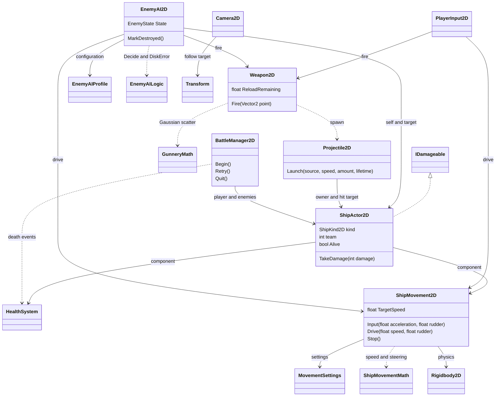
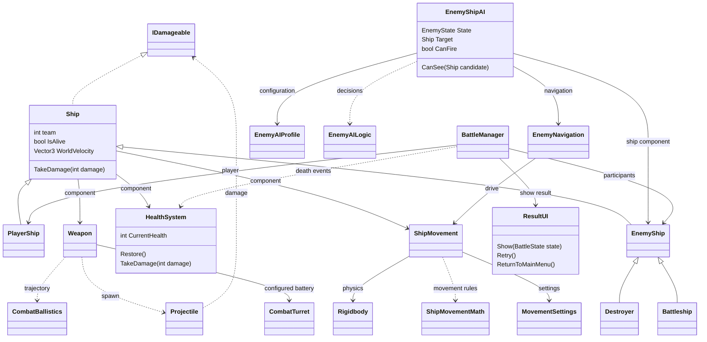

# Final class maps

Verified against 2D `cac76c4` and integrated 3D `1e5fd09`. These are maps of the principal gameplay classes, not an exhaustive inventory of imported assets or editor tools. Solid open triangles mean inheritance; dotted open triangles mean interface implementation; labelled arrows mean component references or use, not inheritance. Unity components remain engine-dependent.

## 2D final

Entry: `Assets/_Game/Scenes/Battle2D.unity`. Source: `Assets/_Game/Battle2D/Runtime`.

`ShipActor2D` combines identity, health and movement. `ShipKind2D` is an enum, not an inheritance tree. `PlayerInput2D`, `Camera2D` and UI in `BattleManager2D` are input/presentation adapters. Movement, projectile collision and AI perception are 2D engine adapters. `BattleManager2D` owns the start/result/retry lifecycle and evaluates defeat before victory.

Shared types: `IDamageable`, `HealthSystem`, `MovementSettings`, `ShipMovementMath`, `GunneryMath`, `EnemyAIProfile`, `EnemyAILogic`; also state enums. Health is a MonoBehaviour and AI profiles are ScriptableObjects. Sharing these does not make the full model engine-independent. 2D directly uses only applicable AI decisions; it does not implement the complete 3D navigation/retreat system.

## 3D final

Art/water battlefield: `FreeNavalBattle.unity`. Menu-flow scene: `IntegratedGame.unity`. These are separate saved scenes; the flow section below describes the latter and must not imply it is attached to every battlefield.

Gameplay model: ship identity, damage, health, weapon state and result rules. Engine execution: Rigidbody movement, turret transforms, projectile casts, AI sensing/navigation. Input/presentation: player input, combat aim/camera/HUD, result UI and water rendering. `CombatHUD` displays predictions; it does not determine projectile hits. `NavalFFT` and `WaterSceneContext` support visual water integration; wave visuals do not replace the mean-sea-plane gameplay collision model.

In `IntegratedGame`, `GameFlowController` gates existing gameplay components during menu/preparation/transition, uses the menu camera/preparation system, and responds to `BattleManager.Ended`. Retry and menu return route through `ResultUI`; ship and camera objects are retained through the initial menu-to-play transition.

## Design decisions and limits

1. Ships combine health, weapon and movement components; the inheritance tree expresses 3D ship identity. This reduces the responsibilities of the ship base class, although its concrete component dependencies still couple it to 3D execution.
2. AI decision helpers and configurable profiles are separated from perception and movement. 2D reuses applicable decisions while providing different physics and avoidance.
3. Separate 2D adapters preserve stable 3D code. The tradeoff is duplicated lifecycle/engine handling and no common ship inheritance tree across dimensions.

The 16-type CCR inventory is a documented subset of core types, not every class in these maps. See [ChangeMap.md](ChangeMap.md).
